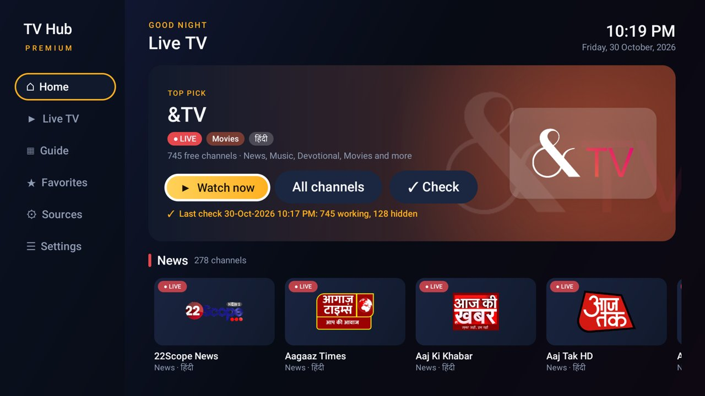
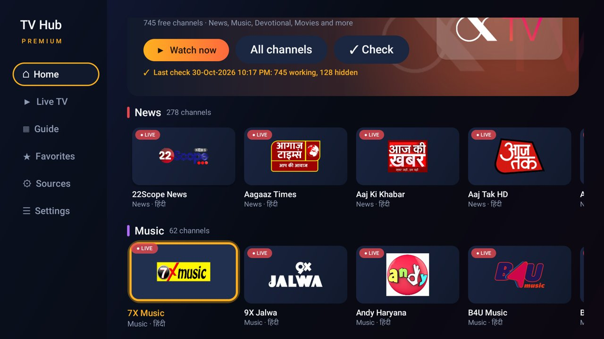
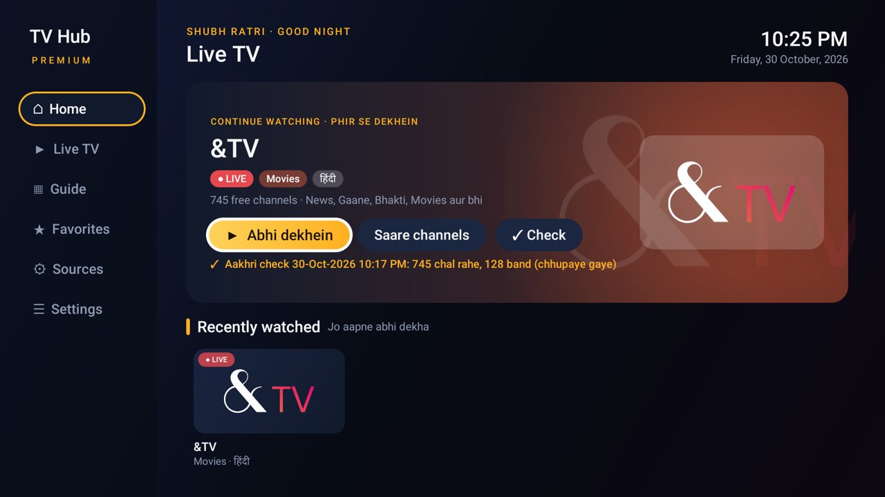
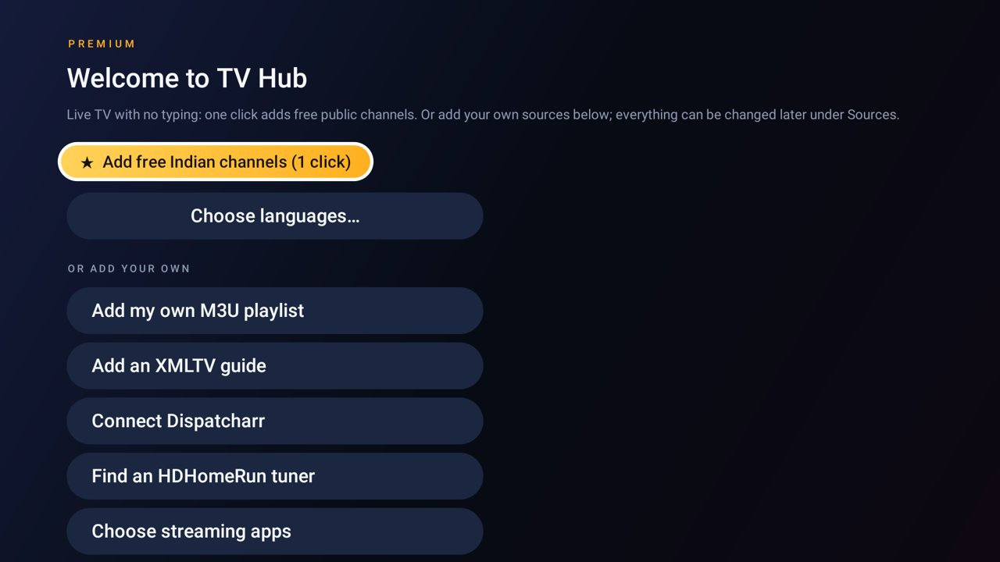
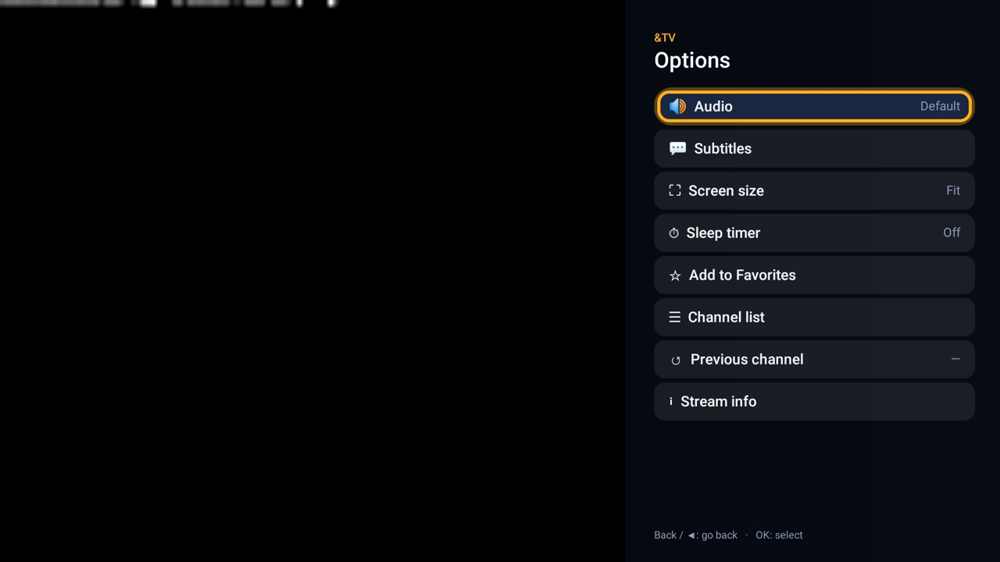
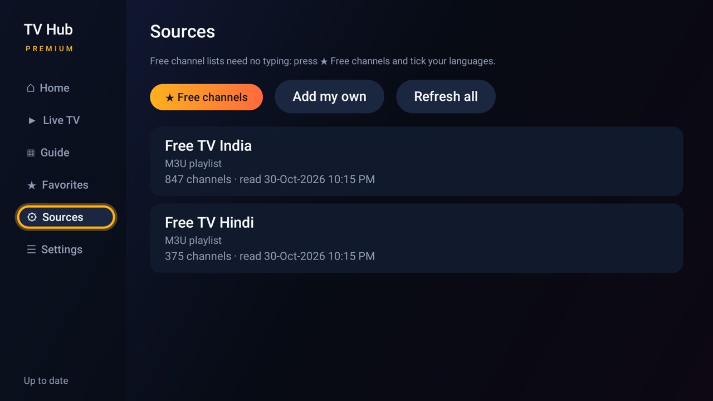
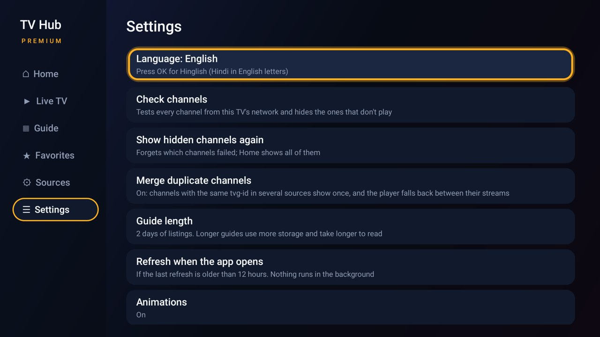

# TV Hub Premium

**Free live TV for Android TV, with a premium look.** One click adds hundreds of free public Indian
channels: news, music, devotional, movies, kids, sports. Hindi channels come first, channels that don't
play are hidden automatically, and the whole app works with a basic TV remote. English and Hinglish.

> **Hinglish mein:** Android TV ke liye free live TV app. Ek click mein sainkdon free Indian channels
> jud jaate hain: News, Gaane, Bhakti, Movies, Bachche, Khel. Hindi channels sabse aage, band channels
> apne aap chhup jaate hain, aur simple remote se sab chalta hai. Settings mein English ya Hinglish chunein.



## Features

- **One-click free channels.** No typing: the welcome screen adds India + Hindi lists in one press, or
  tick your languages (Hindi, Punjabi, Marathi, Gujarati, Bengali, Tamil, Telugu, Kannada, Malayalam, Urdu).
- **Home that feels like a premium TV app.** A *Continue watching* banner, then rows by category
  (News, Music, Devotional, Movies, Entertainment, Kids, Sports, Knowledge) with channel logos.
- **Hindi first.** Channels from the Hindi list lead every row and carry a हिंदी tag.
- **Dead channels hidden.** *✓ Check* tests every channel from your own network and hides the ones that
  don't play. While watching, a channel that fails is skipped after 4 seconds and remembered.
- **TiviMate-style player.** OK opens the channel list over the video; Right opens Options:
  **audio track**, subtitles, screen size (Fit / Fill / Zoom), **sleep timer**, favourite, stream info
  (resolution, codec, bitrate). Up/Down change channel, Left goes to the previous one.
- **Built for basic remotes** like the Mi TV Stick's: everything works with the D-pad, OK and Back.
- **English or Hinglish**, switched in Settings.
- **Light and private.** 1.2 MB, runs on 1 GB RAM sticks, no ads, no accounts, no analytics, nothing
  running in the background. The only network traffic is to the playlists you add and their streams.

## Screenshots

| | |
| :-: | :-: |
|  |  |
| Home (English) | Rows by category, Hindi first |
|  |  |
| Home (Hinglish) | One-click setup |
|  |  |
| Channel list (OK) | Options (Right): audio, screen, sleep timer |
|  |  |
| Sources | Settings: language, channel check |

Video is not visible in screenshots: Android TV keeps the video layer out of screen captures.

## Install on your TV

1. **Download the APK** from [Releases](../../releases/latest)
   (`TVHubPremium.apk`, Android 8.0 or newer, Android TV / Google TV).
2. Put it on the TV, any of these ways:
   - **Downloader app** (Play Store, by AFTVnews): open it on the TV and enter
     `https://github.com/lalitaryan1993/tvhub-premium/releases/latest/download/TVHubPremium.apk`
   - **USB drive** + a file manager on the TV.
   - **ADB** from a computer: `adb install TVHubPremium.apk`
3. Allow "install unknown apps" for the app you used, when Android asks.
4. Open **TV Hub Premium** from the Apps list and press **★ Add free Indian channels (1 click)**.
5. After the channels load, press **✓ Check** once so only working channels stay on Home.

**Is the APK really from this repo?** Its signing certificate SHA-256 is
`3dedbfba236bc4eaa0b9cdef9fb4f3966e81956ae76261a12e9fda5304ea640e`
(check with `apksigner verify --print-certs TVHubPremium.apk`). Every release is signed with this key,
so updates install over the old version and keep your channels and favourites.

## Using it with the remote

| Where | Button | Does |
| :- | :- | :- |
| Home | OK on a card | Play that channel |
| Home | Hold OK on a card | Add to / remove from Favorites |
| Player | **OK** | Channel list over the video |
| Player | **Right ▶** (or hold OK, or Menu) | Options: audio, subtitles, screen size, sleep timer, favourite, stream info |
| Player | Up / Down | Next / previous channel |
| Player | Left ◀ | Previous channel you watched |
| Player | Digits (if your remote has them) | Tune by channel number |
| Anywhere | Back | Close the panel, then go back |

## Channels: where they come from

TV Hub Premium **does not provide any channels.** The one-click buttons add public playlists from
[iptv-org/iptv](https://github.com/iptv-org/iptv), a community list of **publicly available, free-to-air**
streams that broadcasters themselves put on the internet. You can see and change every list under
**Sources**, or add your own M3U playlist, XMLTV guide, Dispatcharr server or HDHomeRun tuner.

| List | Address |
| :- | :- |
| All of India | `https://iptv-org.github.io/iptv/countries/in.m3u` |
| Hindi | `https://iptv-org.github.io/iptv/languages/hin.m3u` |
| Punjabi / Marathi / Gujarati / Bengali | `.../languages/pan.m3u`, `mar`, `guj`, `ben` |
| Tamil / Telugu / Kannada / Malayalam / Urdu | `.../languages/tam.m3u`, `tel`, `kan`, `mal`, `urd` |

Free public streams come and go: some are offline, some only play inside their own country. That is
what **✓ Check** is for. Paid channels are not in these lists, and this project will never link to
pirated ones. Only add playlists you are allowed to watch.

## Watching on a PC

The same lists play in **VLC** on Windows, macOS or Linux: *Media → Open Network Stream* and paste one
of the addresses above, then open the playlist (Ctrl+L) to pick a channel. A browser version is not
offered because many streams block playback inside web pages.

## Build it yourself

JDK 17 and Android SDK 34, or Docker:

```bash
./gradlew testDebugUnitTest lintRelease assembleDebug
# app/build/outputs/apk/debug/app-debug.apk
```

A signed release with your own key (keep the keystore out of the repo):

```bash
keytool -genkeypair -v -keystore ~/tvhub-release.jks -alias tvhub -keyalg RSA -keysize 4096 -validity 10000
TVHUB_KEYSTORE=~/tvhub-release.jks TVHUB_KEYSTORE_PASSWORD=... TVHUB_KEY_ALIAS=tvhub TVHUB_KEY_PASSWORD=... ./gradlew assembleRelease
```

Kotlin, plain Android views, Media3 (ExoPlayer) for playback, framework SQLite. Minimum Android 8.0
(API 26), target 34. Package `io.github.lalitaryan1993.tvhubpremium`.

```
model/   Channel, Programme, SourceConfig
parse/   M3uParser, XmltvParser, ChannelMerger            (unit-tested)
source/  Providers (M3U, XMLTV, Dispatcharr), HdHomeRun, Apps
data/    Repository, Db, Health (channel check), SecureStore, Http, Prefs
ui/      Home, Shelves (category rows), FreeTv (one-click lists), Lang (English/Hinglish), Settings…
player/  PlayerActivity: channel list, Options sheet, sleep timer, auto-skip
```

## Credits

- Built on **[TV Hub](https://github.com/Gathin23/cleanyourtv/tree/main/addons/tv-hub)** by
  [@maxhayim](https://github.com/maxhayim), part of [CleanYourTV](https://github.com/Gathin23/cleanyourtv)
  (MIT). TV Hub Premium adds the redesign, category rows, one-click free channels, channel check,
  the player's channel list and Options sheet, and English/Hinglish.
- Channel lists: [iptv-org/iptv](https://github.com/iptv-org/iptv).
- Playback: [AndroidX Media3](https://github.com/androidx/media). Other licences:
  [THIRD_PARTY_NOTICES.md](THIRD_PARTY_NOTICES.md).

MIT licence, see [LICENSE](LICENSE). Issues and ideas are welcome in this repo's Issues.
